<p align="center">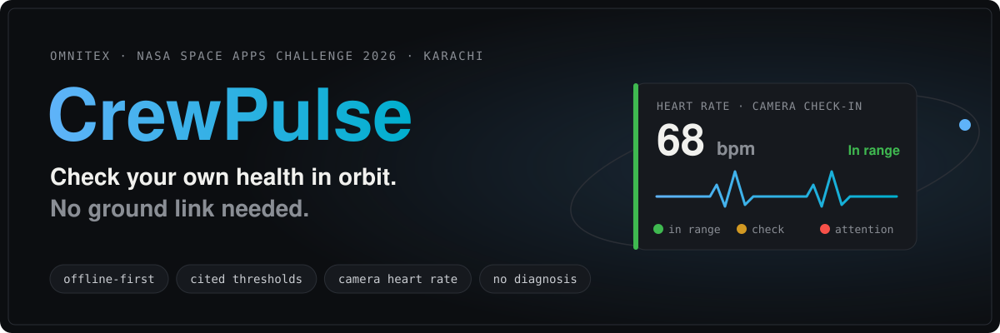</p>

<p align="center">
  <a href="https://arhamurrahemeen.github.io/CrewPulse_NASA_SpaceApps_Challenge_2026/"></a>
  
  
  
  
  
  
  
  
</p>

<p align="center">
  <strong>Offline-first self-health monitoring for astronauts.</strong><br/>
  Log your vitals, scan your heart rate with a webcam, and see when something is unusual <em>for you</em>, with no internet.
</p>

<p align="center"><sub>NASA Space Apps Challenge 2026 · <em>Create Health Monitoring Software for Astronauts on Space Missions</em> · Team OmniteX</sub></p>

<p align="center">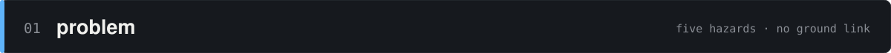</p>

Far from Earth, the crew can't count on the ground. Messages to Mars take up to 20 minutes each way. NASA's Human Research Program groups the dangers into [five hazards](https://www.nasa.gov/hrp/hazards), and every one of them can show up first in an astronaut's own body.

So astronauts need to **check their own health, notice what has changed for them, and know when to call the flight surgeons**, all without a network.

<p align="center">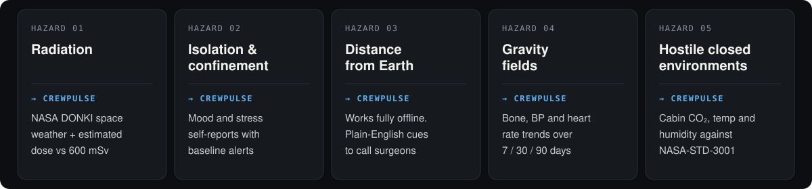</p>

<p align="center">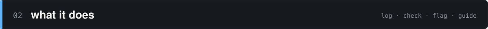</p>

- **Logs what matters:** heart rate, blood pressure, fasting glucose, body temperature, SpO₂, sleep, mood (1–5), stress (0–10), and HRV typed in from a chest-strap ECG.
- **Camera check-in.** A 30-second webcam scan estimates **heart rate only** (rPPG, POS method). A weak signal gets a re-scan request, never a number. HRV and stress never come from the camera.
- **Colour only when cited.** Green, amber and red come from published guidelines (AHA, ADA, CDC, NASA-STD-3001), with the source linked on every card. No source means no colour.
- **Unusual for you.** It flags a reading outside your own 28-day mean ± 2 SD **on two days in a row**, so one odd reading doesn't raise an alarm.
- **Radiation.** Solar flares, CMEs, storms and SEP events from NASA DONKI, cached for offline use, plus a mission dose clearly labelled **ESTIMATE**.
- **Cabin environment.** CO₂, temperature and humidity against NASA-STD-3001 limits, shown next to your vitals.
- **3D body map.** Turn a scan-style 3D figure and click where it hurts to log a symptom (severity 1–5). Front or back is read from where you click. Dots sit on the body for the last 14 days. A flat view and a region list keep it keyboard-friendly.
- **Live 3D, honest data.** The dashboard opens on a procedural Earth with a station on a 51.6° (ISS) orbit, a floating astronaut, and **your vitals as satellites** coloured by their cited status. A 3D *vitals field* plots 30 days of readings as σ from your own baseline. The Radiation page animates the Sun → Earth scene from real DONKI counts.
- **Offline by design.** No CDN, no analytics, no cloud calls. Fonts are bundled, 3D code loads lazily, and even the API docs are bundled.

<p align="center">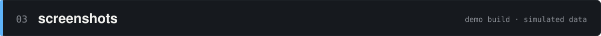</p>

<p align="center"></p>
<p align="center"><sub><b>The dashboard hero.</b> Earth, a station on a 51.6° orbit and an astronaut, all original 3D geometry. The satellites are your latest vitals in their cited status colours: hover or tap one. The headline is computed live.</sub></p>

<p align="center">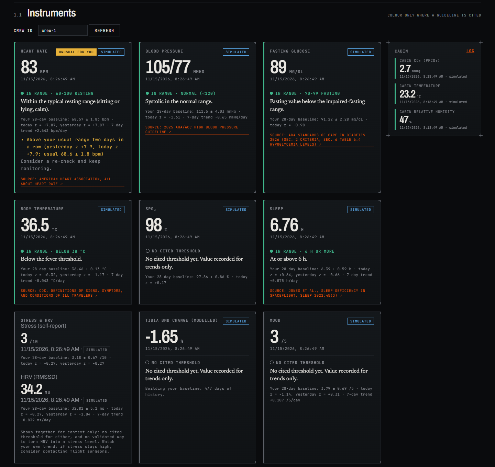</p>
<p align="center"><sub><b>Instruments.</b> Status is always a shape and a word (● ▲ ■ ○), never colour alone. Numerals count up, and each card cites its source.</sub></p>

<p align="center"></p>
<p align="center"><sub><b>Trends over 7, 30 or 90 days.</b> Bands are shaded only where a source exists. Hollow grey dots are simulated.</sub></p>

| | |
|:---:|:---:|
|  | 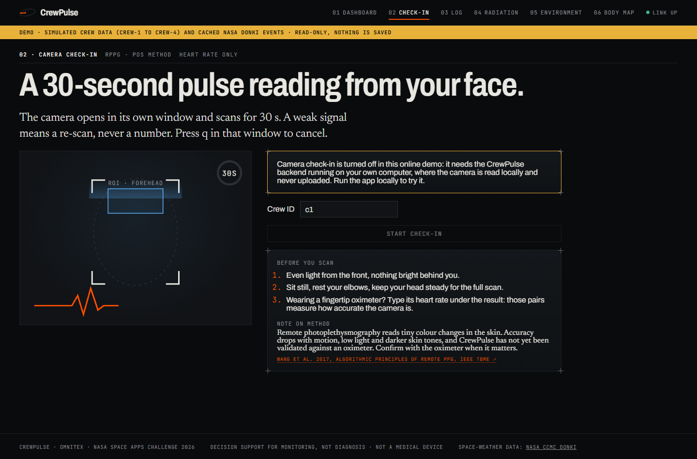 |
| **Radiation.** Flares, CMEs, SEP and storms from DONKI animate a Sun → Earth scene. The dose is labelled an estimate. | **Camera check-in.** An animated viewfinder, a checklist, and an honest method note. |
|  |  |
| **Cabin environment.** CO₂, temperature and humidity against NASA-STD-3001. | **Body map.** Tap a region and log it. A 3D figure, plus a flat view. |

<p align="center"><sub>Captured from the <a href="https://arhamurrahemeen.github.io/CrewPulse_NASA_SpaceApps_Challenge_2026/">live demo</a>, which uses simulated crew data (crew-1 to crew-4) and cached NASA DONKI events.</sub></p>

<p align="center">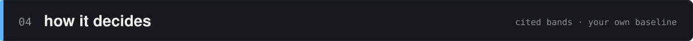</p>

<p align="center">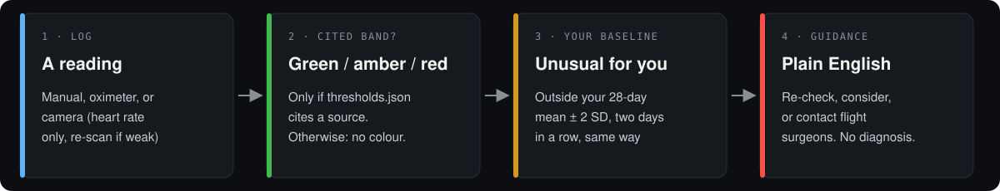</p>

Every threshold lives in [`backend/rules/thresholds.json`](backend/rules/thresholds.json) with a `source_title` and `source_url`. A value nobody has published stays `null` with a todo, and the app shows the reading **uncoloured** instead of guessing. The wording follows fixed rules: *monitoring*, *check*, *consider*, *contact flight surgeons*. It never says *diagnose*.

**Design system.** Art direction *"Flight data, printed"* by Abdul Awwal: deep-space ink, warm greys, and International Orange only for what you can act on. Data is drawn in Earth-limb blue, orange's complement. Every text colour passes WCAG AA. Full tokens, type, motion and 3D notes are in [`DESIGN.md`](DESIGN.md).

<p align="center">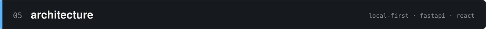</p>

<p align="center">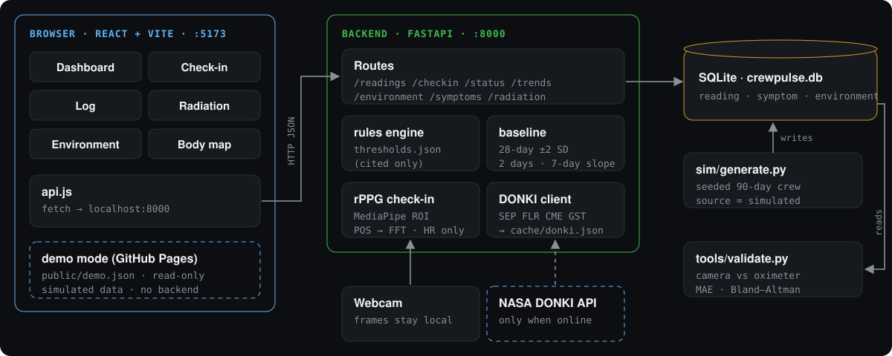</p>

Everything runs on one machine. Camera frames never leave it. The 3D scenes use three.js through React Three Fiber, load after the page, and fall back cleanly without WebGL. The only outside call is DONKI, made when a network happens to be available; otherwise the cache is served and the page shows how old it is.

<p align="center">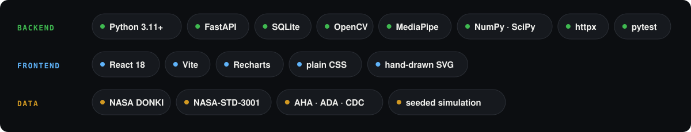</p>

<p align="center">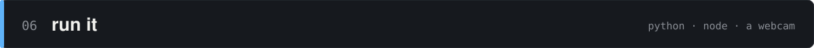</p>

**See it with nothing installed:** open the [live demo](https://arhamurrahemeen.github.io/CrewPulse_NASA_SpaceApps_Challenge_2026/).

**Run it locally.** You need Python 3.11+, Node 20+ and a webcam.

```powershell
# backend: http://localhost:8000, API docs at /docs
cd backend
python -m venv .venv
.venv\Scripts\activate
pip install -r requirements.txt
curl -L -o rppg/models/face_landmarker.task --create-dirs "https://storage.googleapis.com/mediapipe-models/face_landmarker/face_landmarker/float16/1/face_landmarker.task"
uvicorn main:app --reload
```

```powershell
# frontend: http://localhost:5173
cd frontend
npm install
npm run dev
```

Start the backend from your own terminal. The camera preview window only appears in a desktop session.

**Before going offline**, cache space weather and load the simulated crew:

```powershell
cd backend
python -m donki.client
python -m sim.generate --crew 4 --days 90 --seed 42
```

**Tests:** `cd backend && pytest -q`

**Demo build:** `python -m sim.export_demo` writes `frontend/public/demo.json`, and `npm run build:demo` builds the static site. Pushing to `main` deploys it to GitHub Pages. The demo is interactive with no server: what a visitor logs (readings, cabin values, symptoms) is kept only in their own browser and coloured by the same `thresholds.json`. **Reset demo** clears it. The camera check-in needs the local backend.

**Why no hosted backend:** the camera check-in reads the webcam of the machine running the backend, so a cloud server can't do it. There's no login, so a public API would expose health data. Free tiers also wipe SQLite on restart. A local backend plus a static demo keeps the offline-first design honest.

**Check it's really offline:** turn Wi-Fi off and reload the app. In DevTools → Network, the filter `-domain:localhost` should stay empty.

<p align="center">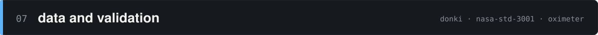</p>

| Source | Used for | Status |
|---|---|---|
| [NASA CCMC DONKI](https://ccmc.gsfc.nasa.gov/tools/DONKI/) | SEP, FLR, CME and GST events for the last 30 days | **Used**, cached in `backend/cache/donki.json` |
| [NASA-STD-3001](https://www.nasa.gov/reference/nasa-std-3001v1/) Vol 1 Rev C and [Vol 2](https://www.nasa.gov/reference/nasa-std-3001v2/) Rev F | 600 mSv career limit [V1 4030]; CO₂ ≤ 3 mmHg [V2 6004]; cabin temperature and humidity [V2 6012], [V2 6013] | **Used.** Neither volume gives resting-vitals limits, so SpO₂ and low temperature stay uncoloured |
| [NASA HRP: 5 Hazards](https://www.nasa.gov/hrp/hazards) | Framing the problem (section 01) | **Used** for framing |
| [NASA OSDR: Inspiration4](https://www.nasa.gov/osdr-latest-news-i4-mission-datasets/) ([Sanders et al. 2024](https://doi.org/10.1038/s41526-024-00393-5)) | Considered for realistic crew data | **Not used.** It holds blood, urine and microbiome omics, not daily vitals |
| AHA, AHA/ACC, ADA, CDC, spaceflight papers | Threshold bands and simulator effects | See [references](#references) |

**Simulated data is always labelled.** The seeded 90-day crew stays inside the cited normal ranges. It adds only effects a source describes: about 6.5 h of sleep in flight (Jones 2022), and −3.4 % tibia bone density over 180 days (Gabel 2022). Every other choice is marked `ASSUMPTION` in the code.

**Validation: camera vs oximeter.** Not measured on real faces yet.

| Metric | Result |
|---|---|
| Camera / oximeter pairs | 7 camera readings, **0 pairs** (as of 2026-11-14) |
| MAE, bias, Bland–Altman 95 % limits | _pending pairs_ |
| Within ±10 % or ±5 bpm | _pending pairs_ |

To collect pairs, wear a fingertip oximeter during a check-in and type its heart rate under the result. Then run `python tools/validate.py --crew c1`. It writes the metrics and a Bland–Altman plot.

What *is* verified, on synthetic signals:
- A 72 bpm pulse sampled at 27 fps is recovered within ±4 bpm.
- Every threshold band edge matches its source.
- The baseline engine fires on planted two-day anomalies and ignores one-day spikes.

**Known failure:** pure noise can pass the 3 dB quality gate. It's kept as a strict `xfail` until real pairs exist to re-tune it.

<p align="center">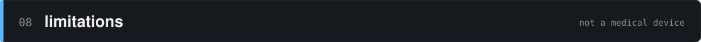</p>

| Working today | Not yet |
|---|---|
| Logging, cited colours, personal baseline, trends | Camera accuracy measured on real faces |
| Camera heart-rate check-in with re-scan | Multi-user accounts, sync and encryption at rest |
| DONKI radiation panel with offline cache | Spaceflight-specific resting-vitals thresholds |
| Cabin environment log and body map | Reminders and a multi-crew view |
| Offline operation, plus a public interactive demo | |
| 3D orbit hero, vitals field, space-weather scene and 3D body map | |

Known limits:

- **Not a medical device.** CrewPulse is decision support for monitoring. It has no clinical validation and never diagnoses.
- **Small n.** The camera has been tried on one person, with no oximeter pairs yet. The earlier green-channel build this code descends from read 15–25 bpm low in one informal test.
- **Skin-tone bias.** In an audit of public rPPG datasets, error rose from about 5 bpm on lighter skin (Fitzpatrick I–III) to about 14 bpm on darker skin (V–VI) ([Bondarenko et al. 2025](https://doi.org/10.1038/s41746-025-01973-9)). The reference device is biased too: pulse oximeters overestimated SpO₂ more often in Black, Hispanic and Asian patients ([Fawzy et al. 2022](https://doi.org/10.1001/jamainternmed.2022.1906)). Validation needs a range of skin tones.
- **Light and motion** degrade the camera reading, and the quality gate isn't tuned yet.
- **Thresholds are terrestrial** unless NASA-STD-3001 gives a value.
- **The baseline needs 7 days of history** and assumes a steady routine.
- **The dose is an estimate** from ISS averages, not a dosimeter reading. SEP events can add dose it doesn't include.
- **Cabin checks are approximate.** A 1-hour CO₂ average limit is applied to single readings, and ppm → mmHg assumes a 1 atm cabin.
- **Symptom severity is self-reported** and not graded, because no cited cut-off exists.

<p align="center">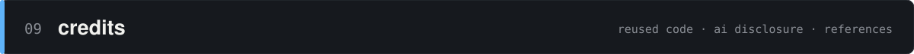</p>

**Reused code.** `backend/rppg/roi.py`, `lighting.py` and `dsp_pipeline.py` are adapted from [VitalSense](https://github.com/Arhamurrahemeen/VitalSense) (MIT), the team lead's own earlier open-source project, at commit [`61a0b0ccb07cf1a3ac8cc22252e86edb62f97e21`](https://github.com/Arhamurrahemeen/VitalSense/commit/61a0b0ccb07cf1a3ac8cc22252e86edb62f97e21). They were reused with permission of the Karachi Local Lead, and each file carries an attribution header. Everything else was written for this hackathon.

**Design.** Art direction, colour tokens and the 3D vitals-field concept: **Abdul Awwal** (OmniteX). See [`DESIGN.md`](DESIGN.md), including what we left out of his package and why.

**Bundled for offline use:**
- Swagger UI 5.34.1 (`backend/static/swagger/`, Apache-2.0)
- three.js 0.172, @react-three/fiber 8.18, @react-three/drei 9.122 (MIT)
- Archivo, Newsreader (SIL OFL) and JetBrains Mono (OFL) through @fontsource, served from the app itself
- MediaPipe Face Landmarker model (downloaded, not committed; Apache-2.0)

**AI-assistance disclosure.** CrewPulse was built with **Claude Code** (Anthropic), an AI coding assistant. It wrote and edited code, tests and documentation under the team's direction. The team checked thresholds and sources against primary documents and tested every feature in the browser.
**The idea, product design and decisions are the team's:** what to build, which indicators to track, the offline-first approach, the safety rules (cited thresholds only, no diagnosis, heart rate only from the camera) and the scope. The figure, diagrams and banner in this README are original SVG. No NASA logos or branding are used.

### References

<details>
<summary>Show all references</summary>

Thresholds and spaceflight context:
- Blood pressure: 2025 AHA/ACC Guideline for the Prevention, Detection, Evaluation and Management of High Blood Pressure in Adults. https://doi.org/10.1161/CIR.0000000000001356
- Glucose: American Diabetes Association, Standards of Care in Diabetes 2026. https://diabetesjournals.org/care/issue/49/Supplement_1
- Resting heart rate 60–100 bpm: American Heart Association, All About Heart Rate (Pulse). https://www.heart.org/en/health-topics/high-blood-pressure/the-facts-about-high-blood-pressure/all-about-heart-rate-pulse
- Fever ≥ 38 °C (100.4 °F): CDC, Definitions of Signs, Symptoms, and Conditions of Ill Travelers. https://www.cdc.gov/quarantine/maritime/definitions-signs-symptoms-conditions-ill-travelers.html
- Sleep < 5 h risk: Jones CW et al., *SLEEP* 2022. https://doi.org/10.1093/sleep/zsac006 (https://read.qxmd.com/read/35023565)
- Cardiovascular changes: Krittanawong C et al., *Prog Cardiovasc Dis* 2023. https://doi.org/10.1016/j.pcad.2023.07.009
- Bone loss: Gabel L et al., *Sci Rep* 2022. https://doi.org/10.1038/s41598-022-13461-1
- Behavioural health: NASA OCHMO TB-016. https://www.nasa.gov/ochmo/health-operations-and-oversight/hsa-standards/
- Spaceflight limits: NASA-STD-3001 Vol 1 Rev C (https://www.nasa.gov/reference/nasa-std-3001v1/) and Vol 2 Rev F (https://www.nasa.gov/reference/nasa-std-3001v2/)
- Cabin CO₂ ≤ 3 mmHg (1-hour average): NASA-STD-3001 Vol 2 [V2 6004]; NASA OCHMO-TB-004 Carbon Dioxide. https://www.nasa.gov/wp-content/uploads/2023/12/ochmo-tb-004-carbon-dioxide.pdf
- Cabin temperature and humidity: NASA-STD-3001 Vol 2 [V2 6012] (18–27 °C, 25–75 % RH) and [V2 6013] (20–25 °C, 30–60 % RH); NASA OCHMO-TB-003 Habitable Atmosphere. https://www.nasa.gov/wp-content/uploads/2023/12/ochmo-tb-003-habitable-atmosphere.pdf
- Career dose limit 600 mSv: NASA-STD-3001 Vol 1 Rev C, [V1 4030]
- Estimated ISS dose 80 mSv (solar max) to 160 mSv (solar min) per 6 months: NASA, *Space Faring: The Radiation Challenge*. https://www.nasa.gov/wp-content/uploads/2017/04/radiationchallenge.pdf

Data:
- NASA Community Coordinated Modeling Center (CCMC), DONKI. https://ccmc.gsfc.nasa.gov/tools/DONKI/
- NASA Human Research Program, 5 Hazards of Human Spaceflight. https://www.nasa.gov/hrp/hazards
- NASA OSDR, Inspiration4 mission datasets (reviewed, not used). https://www.nasa.gov/osdr-latest-news-i4-mission-datasets/ · Sanders LM et al., *npj Microgravity* 2024. https://doi.org/10.1038/s41526-024-00393-5

Method and limitations:
- Heart-rate accuracy criterion ±10 % or ±5 bpm: IEC 60601-2-27, as quoted by device makers. The standard itself is paywalled and was not checked.
- Bondarenko M, Menon C, Elgendi M. Demographic bias in public remote photoplethysmography datasets. *npj Digital Medicine* 2025;8:593. https://doi.org/10.1038/s41746-025-01973-9
- Fawzy A et al. Racial and Ethnic Discrepancy in Pulse Oximetry and Delayed Identification of Treatment Eligibility Among Patients With COVID-19. *JAMA Intern Med* 2022. https://doi.org/10.1001/jamainternmed.2022.1906
- POS method: Wang W, den Brinker AC, Stuijk S, de Haan G. Algorithmic Principles of Remote PPG. *IEEE Trans Biomed Eng* 2017;64(7):1479–1491. https://doi.org/10.1109/TBME.2016.2609282 (method attribution, not used as evidence)

</details>

<p align="center">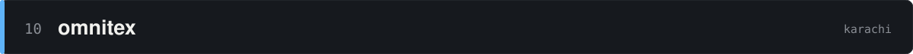</p>

CrewPulse was built for NASA Space Apps Challenge 2026 (Karachi) by team **OmniteX**: Muhammad Arham (lead) and Abdul Awwal. [**OmniteX**](https://omnitex.netlify.app) is based at NASTP Silicon Valley, Karachi.

MIT © 2026 Muhammad Arham. See [LICENSE](LICENSE).

<p align="center"><sub>Built in Karachi by <a href="https://github.com/Arhamurrahemeen">Arham</a>, founder of OmniteX.</sub></p>
