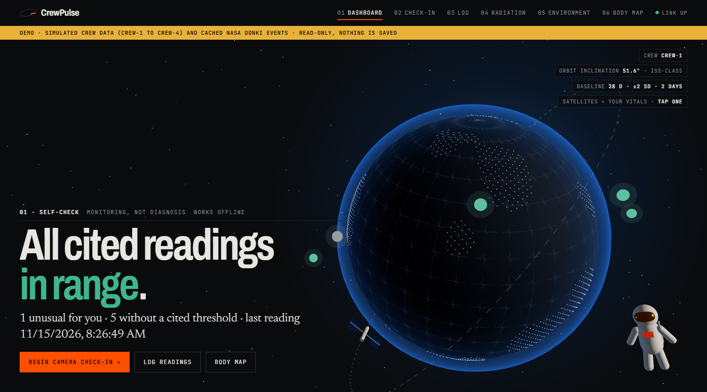
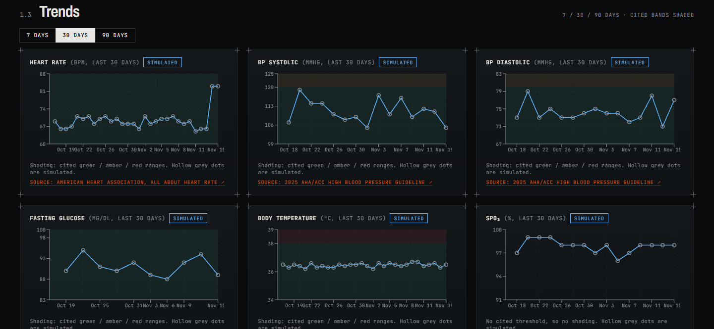
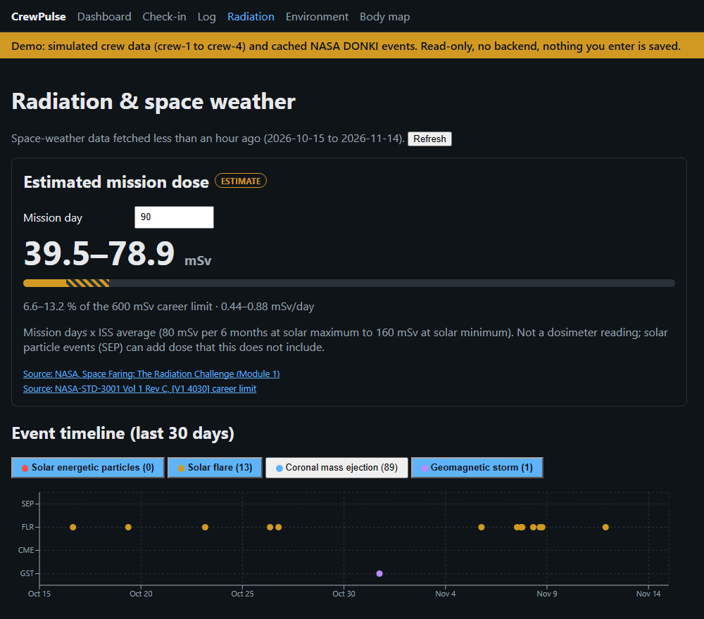
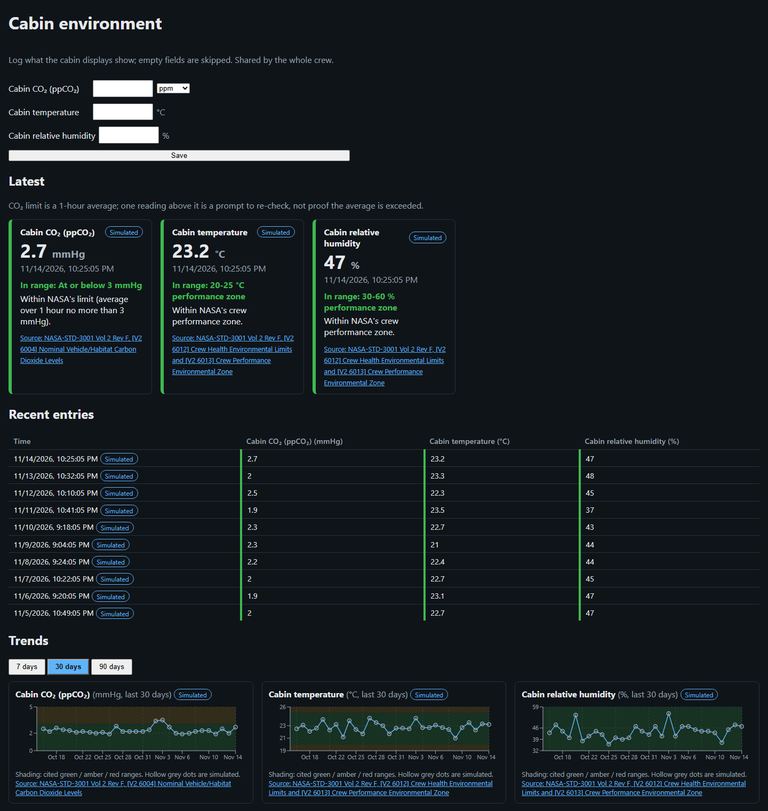
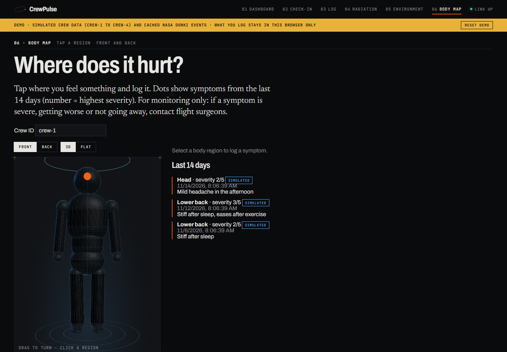
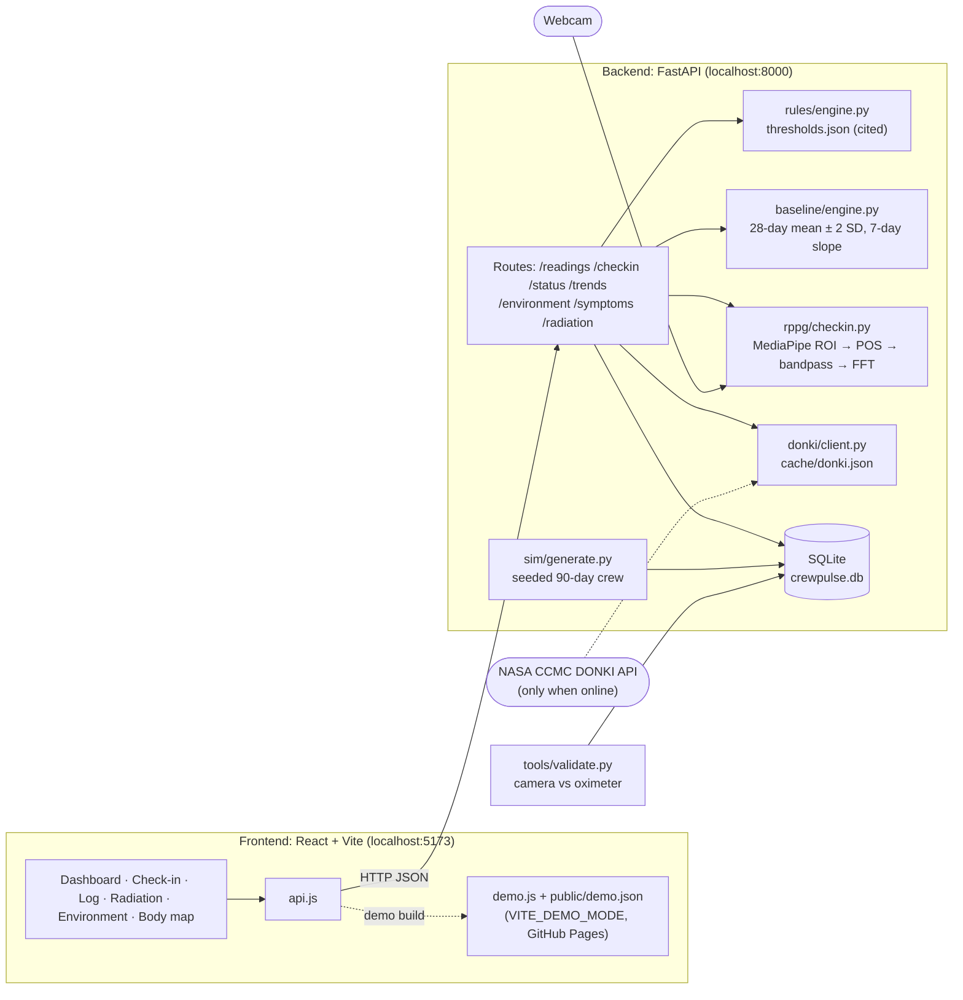

# CrewPulse

**Offline-first self-health monitor for astronauts.** NASA Space Apps Challenge 2026, Karachi.
Challenge: *Create Health Monitoring Software for Astronauts on Space Missions*. Team **OmniteX**: Muhammad Arham (lead), Abdul Awwal.

**Live demo (simulated data, no backend):** https://arhamurrahemeen.github.io/CrewPulse_NASA_SpaceApps_Challenge_2026/

> CrewPulse is decision support for self-monitoring. It is **not a medical device** and does not diagnose. When in doubt it says: contact flight surgeons.

## The problem

On long missions the crew cannot count on the ground. NASA's Human Research Program groups the risks into
[five hazards](https://www.nasa.gov/hrp/hazards): radiation, isolation and confinement, distance from Earth,
gravity fields, and hostile closed environments. With distance, communication delays grow (up to about 20 minutes each
way at Mars), so astronauts need to check their own health, notice when something changes **for them**, and know when
to call the flight surgeons, without an internet connection.

| Hazard | Where CrewPulse helps |
|---|---|
| Radiation | Space-weather events from NASA DONKI and an estimated mission dose (clearly labelled as an estimate) |
| Isolation and confinement | Mood (1–5) and stress (0–10) self-reports with personal-baseline alerts |
| Distance from Earth | Works fully offline; plain-English guidance and "contact flight surgeons" cues |
| Gravity fields | Bone-loss trend (simulated, from published flight data), BP and heart-rate tracking |
| Hostile closed environments | Cabin CO₂, temperature and humidity log against NASA-STD-3001 limits |

## What it does

- **Logs readings:** heart rate, blood pressure, fasting glucose, body temperature, SpO₂, sleep hours, mood, stress, and HRV (RMSSD, typed in from a chest-strap ECG or similar device).
- **Camera check-in:** a 30 s webcam scan estimates **heart rate only** (rPPG, POS method). If signal quality is low it asks for a re-scan instead of showing a number. HRV and stress are never derived from the camera.
- **Colour-codes readings** green/amber/red against **cited** thresholds only. A reading with no cited threshold is shown without colour.
- **Personal baseline:** a reading is flagged "Unusual for you" when it is outside your 28-day mean ± 2 SD **on two consecutive days in the same direction**. It also reports a 7-day trend.
- **Trends:** 7/30/90-day charts with the threshold bands shaded. Simulated points are drawn hollow and badged.
- **Radiation:** solar flares, CMEs, geomagnetic storms and SEP events from NASA DONKI (cached for offline use), plus an estimated mission dose compared with the NASA career limit.
- **Environment log:** cabin CO₂ (entered as ppm or mmHg), temperature and humidity, with a table, charts and a summary beside the health dashboard.
- **Body map:** tap a region of an original SVG figure (front and back) to log a symptom with a severity of 1–5 and a note. Dots show the last 14 days.
- **Offline by design:** no CDN, fonts, analytics or cloud calls at runtime. DONKI is fetched when online and served from disk otherwise.

## Screenshots

> Placeholders: add images to `docs/screenshots/` before submission.

| | |
|---|---|
|  |  |
|  |  |
|  |  |

## Architecture



## How to run

Requirements: Python 3.11+, Node 20+, a webcam for the check-in. Windows commands shown; on macOS/Linux use `source .venv/bin/activate`.

**Backend** (http://localhost:8000, API docs at `/docs`):

```
cd backend
python -m venv .venv
.venv\Scripts\activate
pip install -r requirements.txt
curl -L -o rppg/models/face_landmarker.task --create-dirs "https://storage.googleapis.com/mediapipe-models/face_landmarker/face_landmarker/float16/1/face_landmarker.task"
uvicorn main:app --reload
```

Start it from your own terminal: the camera preview window only appears when the backend runs in a desktop session.
The face model (about 3.7 MB) is gitignored.

**Frontend** (http://localhost:5173):

```
cd frontend
npm install
npm run dev
```

**While online, before going offline:**

```
cd backend
python -m donki.client                              # cache space-weather events
python -m sim.generate --crew 4 --days 90 --seed 42 # simulated crew-1..crew-4 (labelled "Simulated")
```

**Tests:** `cd backend && pytest -q`

**Demo build** (static, read-only, simulated data):

```
cd backend && python -m sim.export_demo     # writes frontend/public/demo.json
cd ../frontend && npm run build:demo        # static site in frontend/dist-demo/
```

Pushing to `main` deploys it to GitHub Pages through `.github/workflows/pages.yml`.

**Check it works offline:** turn Wi-Fi off, reload the app, and check that DevTools → Network filtered with `-domain:localhost` stays empty.

## Data sources

| Source | Used for | Status |
|---|---|---|
| [NASA CCMC DONKI](https://ccmc.gsfc.nasa.gov/tools/DONKI/) (API `https://ccmc.gsfc.nasa.gov/DONKI-API/get/<TYPE>`) | SEP, FLR, CME and GST events for the last 30 days on the Radiation page | **Used**, cached in `backend/cache/donki.json` |
| [NASA-STD-3001](https://www.nasa.gov/reference/nasa-std-3001v1/) Vol 1 Rev C and [Vol 2](https://www.nasa.gov/reference/nasa-std-3001v2/) Rev F | 600 mSv career dose limit [V1 4030]; cabin CO₂ ≤ 3 mmHg [V2 6004]; temperature/humidity limits [V2 6012] and [V2 6013] | **Used** in `thresholds.json` and the dose panel. No resting-vitals limits were found in either volume, so SpO₂ and low temperature are uncoloured |
| [NASA HRP: 5 Hazards of Human Spaceflight](https://www.nasa.gov/hrp/hazards) | Problem framing (table above) | **Used** for framing only |
| [NASA OSDR: Inspiration4 datasets](https://www.nasa.gov/osdr-latest-news-i4-mission-datasets/) ([Sanders et al. 2024](https://doi.org/10.1038/s41526-024-00393-5)) | Reviewed as a source for realistic crew data | **Not used.** The I4 data is biospecimen/omics (blood, urine, microbiome), not daily vital signs, so it could not feed the simulator without inventing a mapping |
| Clinical guidelines (AHA, AHA/ACC, ADA, CDC) and spaceflight papers | Threshold bands and simulator effects | See [References](#references) |

**Simulated data is always labelled.** The 90-day crew history (`sim/generate.py`, seed 42) draws values inside the cited normal ranges. It adds only spaceflight effects a source describes: about 6.5 h of sleep (Jones 2022), and −3.4 % tibia bone density over 180 days (Gabel 2022). Every other choice is marked `ASSUMPTION` in the code. One anomaly is planted per crew member to demo the baseline alert.

## Validation

**Camera heart rate vs pulse oximeter, real faces: not measured yet.**

As of 2026-11-14 the database holds 7 camera readings and **0 oximeter pairs**, so there are no agreement numbers to report.
`tools/validate.py` computes them once pairs exist: MAE, bias, Bland–Altman 95 % limits of agreement, the share within
±10 % or ±5 bpm, and a sweep over the quality gate.

To collect pairs: wear a fingertip oximeter during a check-in, then enter its heart rate in the "Oximeter" box under the
result (or on the Log page with "From oximeter"). Then run:

```
python tools/validate.py --crew c1     # prints the table, writes tools/bland_altman.png
```

| Metric | Result |
|---|---|
| Pairs (n) | _pending_ |
| MAE (bpm) | _pending_ |
| Bias ± 1.96 SD (bpm) | _pending_ |
| Within ±10 % or ±5 bpm | _pending_ |

**What is verified (synthetic signals, `backend/tests/`):**
- A 72 bpm signal sampled at 27 fps is recovered within ±4 bpm. The measured fps is passed to every filter and FFT step, never the 30 fps default.
- Every threshold band edge is tested against the cited value. The baseline engine fires on the planted two-day anomalies and ignores single-day spikes.
- **Known failure (kept as a strict `xfail`):** pure noise can pass the 3 dB quality gate. The gate has to be re-tuned from real camera-and-oximeter pairs before the camera reading can be trusted.

## Limitations

- **Not a medical device.** Not cleared or validated for clinical use. Colours and guidance are monitoring aids, and the app never diagnoses.
- **Small n.** The camera heart rate has been tried on one person, with no oximeter pairs yet. Earlier informal tests of the reused green-channel build read 15–25 bpm low at high confidence. POS on real faces is unvalidated (see Validation).
- **Skin-tone bias.** Camera rPPG is less accurate on darker skin ([Nowara et al., CVPRW 2020](https://openaccess.thecvf.com/content_CVPRW_2020/html/w19/Nowara_A_Meta-Analysis_of_the_Impact_of_Skin_Tone_and_Gender_CVPRW_2020_paper.html)). Pulse oximeters themselves overestimate SpO₂ in Black patients ([Sjoding et al., NEJM 2020](https://doi.org/10.1056/NEJMc2029240)), so the reference device is not neutral either. Validation should include a range of skin tones.
- **Lighting and motion** degrade rPPG. Low quality triggers a re-scan, but the gate is not yet tuned (see above).
- **Thresholds are terrestrial** (AHA, ADA, CDC) except where NASA-STD-3001 gives a value. Spaceflight norms for resting vitals were not found, so those indicators are left uncoloured rather than guessed.
- **Personal baseline needs history:** 7 days before it shows anything. It assumes a stable routine.
- **Dose is an estimate** from ISS mission averages, not a dosimeter reading. SEP events can add dose it does not include.
- **Cabin limits:** CO₂ is a 1-hour-average limit applied to single readings. The ppm → mmHg conversion assumes a 1 atm cabin. The temperature/humidity envelope is checked per axis (approximate near its corners).
- **Body-map severity** is a self-report. It is not graded against a threshold, because no cited cut-off exists.
- **Single-user, local.** No authentication, no sync, no encryption at rest.

## Reused code

`backend/rppg/roi.py`, `lighting.py` and `dsp_pipeline.py` are adapted from
[VitalSense](https://github.com/Arhamurrahemeen/VitalSense), the team lead's own prior open-source work (MIT), at commit
[`61a0b0ccb07cf1a3ac8cc22252e86edb62f97e21`](https://github.com/Arhamurrahemeen/VitalSense/commit/61a0b0ccb07cf1a3ac8cc22252e86edb62f97e21).
They were reused with permission of the Karachi Local Lead, and each file carries an attribution header. `checkin.py` and everything else is new for this hackathon.

Third-party assets bundled for offline use:
- Swagger UI 5.34.1 (`backend/static/swagger/`, Apache-2.0, licence included)
- MediaPipe Face Landmarker model (downloaded, not committed; Apache-2.0)

## AI-assistance disclosure

CrewPulse was built with the help of **Claude Code** (Anthropic), an AI coding assistant. It wrote and edited code, tests and documentation under the team's direction. The team checked thresholds and sources against primary documents and tested features in the browser.
**The idea, product design and decisions are the team's**: what to build, which indicators to track, the offline-first approach, the safety rules (cited thresholds only, no diagnosis, heart rate only from the camera), and the scope.

## References

Thresholds and spaceflight context:
- Blood pressure: 2025 AHA/ACC Guideline for the Prevention, Detection, Evaluation and Management of High Blood Pressure in Adults. https://doi.org/10.1161/CIR.0000000000001356
- Glucose: American Diabetes Association, Standards of Care in Diabetes 2026. https://diabetesjournals.org/care/issue/49/Supplement_1
- Resting heart rate 60–100 bpm: American Heart Association, All About Heart Rate (Pulse). https://www.heart.org/en/health-topics/high-blood-pressure/the-facts-about-high-blood-pressure/all-about-heart-rate-pulse
- Fever ≥ 38 °C (100.4 °F): CDC, Definitions of Signs, Symptoms, and Conditions of Ill Travelers. https://www.cdc.gov/quarantine/maritime/definitions-signs-symptoms-conditions-ill-travelers.html
- Sleep < 5 h risk: Jones CW et al., *SLEEP* 2022. https://doi.org/10.1093/sleep/zsac006 (https://read.qxmd.com/read/35023565)
- Cardiovascular changes: Krittanawong C et al., *Prog Cardiovasc Dis* 2023. https://doi.org/10.1016/j.pcad.2023.07.009
- Bone loss: Gabel L et al., *Sci Rep* 2022. https://doi.org/10.1038/s41598-022-13461-1
- Behavioural health: NASA OCHMO TB-016. https://www.nasa.gov/ochmo/health-operations-and-oversight/hsa-standards/
- Spaceflight limits: NASA-STD-3001 Vol 1 Rev C (https://www.nasa.gov/reference/nasa-std-3001v1/) and Vol 2 Rev F (https://www.nasa.gov/reference/nasa-std-3001v2/)
- Cabin CO₂ ≤ 3 mmHg (1-hour average): NASA-STD-3001 Vol 2 [V2 6004]; background in NASA OCHMO-TB-004 Carbon Dioxide. https://www.nasa.gov/wp-content/uploads/2023/12/ochmo-tb-004-carbon-dioxide.pdf
- Cabin temperature/humidity: NASA-STD-3001 Vol 2 [V2 6012] Crew Health Environmental Limits (18–27 °C, 25–75 % RH) and [V2 6013] Crew Performance Environmental Zone (20–25 °C, 30–60 % RH); background in NASA OCHMO-TB-003 Habitable Atmosphere. https://www.nasa.gov/wp-content/uploads/2023/12/ochmo-tb-003-habitable-atmosphere.pdf
- Career dose limit 600 mSv: NASA-STD-3001 Vol 1 Rev C, [V1 4030]
- Estimated ISS dose 80 mSv (solar max) to 160 mSv (solar min) per 6 months: NASA, *Space Faring: The Radiation Challenge*. https://www.nasa.gov/wp-content/uploads/2017/04/radiationchallenge.pdf

Data:
- Space-weather events: NASA Community Coordinated Modeling Center (CCMC), DONKI. https://ccmc.gsfc.nasa.gov/tools/DONKI/
- NASA Human Research Program, 5 Hazards of Human Spaceflight. https://www.nasa.gov/hrp/hazards
- NASA OSDR, Inspiration4 mission datasets (reviewed, not used). https://www.nasa.gov/osdr-latest-news-i4-mission-datasets/ · Sanders LM et al., Inspiration4 data access through the NASA Open Science Data Repository, *npj Microgravity* 2024. https://doi.org/10.1038/s41526-024-00393-5

Method and limitations:
- Heart-rate accuracy criterion ±10 % or ±5 bpm: IEC 60601-2-27, as quoted by device makers. The standard itself is paywalled and was not checked.
- Nowara EM, McDuff D, Veeraraghavan A. A Meta-Analysis of the Impact of Skin Tone and Gender on Non-Contact Photoplethysmography Measurements. CVPR Workshops 2020. https://openaccess.thecvf.com/content_CVPRW_2020/html/w19/Nowara_A_Meta-Analysis_of_the_Impact_of_Skin_Tone_and_Gender_CVPRW_2020_paper.html
- Sjoding MW et al. Racial Bias in Pulse Oximetry Measurement. *N Engl J Med* 2020;383:2477–2478. https://doi.org/10.1056/NEJMc2029240

## License

MIT © 2026 Muhammad Arham. See [LICENSE](LICENSE). No NASA logos or branding are used. NASA data is credited above.
